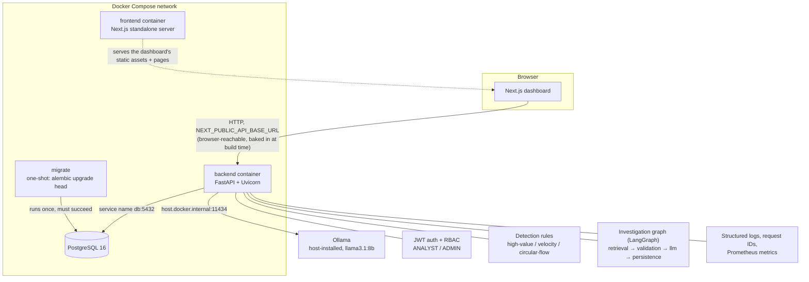

# SentinelBank AI — Release Candidate

A banking fraud-investigation prototype: rule-based detection, an LLM-driven investigation workflow with anti-hallucination citation checking, role-based access control, and a Docker deployment path. Built as a demonstration of the full path from detection to a human-reviewed, audited decision — not a production banking system.

This document is the top-level entry point for evaluating the project. It links out to the detailed docs rather than duplicating them:

- [`DEPLOYMENT.md`](DEPLOYMENT.md) — setup guide, environment variables, startup order, backup/restore, troubleshooting.
- [`API_CONTRACT.md`](API_CONTRACT.md) — the actual, implemented request/response shapes.

## Architecture



The investigation graph's anti-hallucination step is the architecturally interesting part: the LLM must cite specific transaction refs/account numbers, and anything cited that wasn't actually in the retrieved evidence bundle is rejected as a hallucination (the report is persisted as `FAILED`, not silently accepted) — see `backend/investigation/nodes.py`'s `make_llm_node`.

## Setup

See [`DEPLOYMENT.md`](DEPLOYMENT.md) for the full guide. Short version:

```bash
cp .env.example .env    # then edit in real values -- see DEPLOYMENT.md §1
docker compose up --build -d
```

## Environment variables

Full table with rationale in [`DEPLOYMENT.md` §1](DEPLOYMENT.md#1-environment-setup). Summary: `POSTGRES_DB`/`POSTGRES_USER`/`POSTGRES_PASSWORD`, `JWT_SECRET_KEY`, `ACCESS_TOKEN_EXPIRE_MINUTES` are required — Compose refuses to start without them, and the backend separately refuses to start if `JWT_SECRET_KEY` is still the example placeholder. `NEXT_PUBLIC_API_BASE_URL` and `OLLAMA_HOST` are optional, with documented defaults.

## Test commands

```bash
# Backend: full suite, including the formal E2E regression test
cd backend && pytest -q

# Frontend: lint and production build
cd frontend && npm run lint && npm run build
```

Backend tests are fully hermetic (isolated SQLite per test, no live server, no real Ollama call) — see `backend/tests/conftest.py`'s `api_client` fixture and `backend/tests/test_e2e_regression.py`.

## Release evidence

Captured against commit `bf7e8c4` (the commit immediately preceding this document):

| Check | Result |
|---|---|
| Backend test suite | **101 passed**, 0 failed (`pytest -q`, Python 3.13.1, locally) |
| Backend test suite, inside the pinned Docker image | **101 passed**, 0 failed — run with `docker run` against the exact image built from `backend/Dockerfile` + pinned `requirements.txt`, proving local and containerized dependency sets actually match, not just that they're declared the same |
| Frontend lint | Clean (`eslint`, 0 errors/warnings) |
| Frontend production build | Succeeds; all 7 routes build (`/`, `/alerts`, `/alerts/[id]`, `/evaluation`, `/login`, `/network`, `/_not-found`); `output: "standalone"` confirmed to produce a working `.next/standalone/server.js` |
| Isolated clean-install Compose verification | Full stack (`db` → `migrate` → `backend` → `frontend`) built and started from a genuinely empty Postgres volume, under a separate Compose project name/container names/ports so the real dev database was never touched. Verified: migration ran to completion, both demo accounts logged in, RBAC returned 403 for analyst-attempted admin action, `NEXT_PUBLIC_API_BASE_URL` was confirmed present in the actual built JS chunk (not just in source) |
| Real (non-mocked) investigation workflow through the containerized stack | A synthetic high-value transaction was created via the API, detection raised an alert, `/alerts/{id}/investigate` ran a **real** call to a host-installed Ollama (`llama3.1:8b`) from inside the container, produced a grounded `PENDING_REVIEW` report, which was then reviewed (`APPROVED`) by the analyst account — full round trip, no fakes |
| Backup/restore | Backup (~1s) and restore into a scratch database (~1.5s) both run against the real dev database (non-destructively) and table/row counts (users, alerts, transactions) confirmed to match the source. Repeated twice across this project's work, with consistent results both times |
| Secrets isolation | Built backend image scanned — contains no `.env*` file. Built frontend bundle (`.next/static` + `.next/standalone`) scanned for every secret-shaped string the app uses — zero matches; the only `process.env` reference in `frontend/src` is the intentionally public `NEXT_PUBLIC_API_BASE_URL` |
| Secrets enforcement | `docker compose up` with an empty env file fails immediately with `required variable ... is missing a value` for `POSTGRES_DB`/`USER`/`PASSWORD`/`JWT_SECRET_KEY`. Backend separately refuses to import if `JWT_SECRET_KEY` equals the literal `.env.example` placeholder string (demonstrated directly, not just asserted) |

## Threat model

**In scope / addressed:**
- Authentication: JWT, PBKDF2-HMAC-SHA256 password hashing (260k iterations, OWASP-current minimum for PBKDF2).
- Authorization: role-based (`ANALYST` / `ADMIN`), enforced server-side on every sensitive route (detection run, metrics endpoint) — never trust a client-side role claim without a server check.
- Reviewer identity: taken from the authenticated session, never a client-supplied field — a review can't be forged as someone else.
- Duplicate/concurrent review: rejected with 409 via an atomic conditional `UPDATE`, not a check-then-write race.
- Error responses: a consistent `{"detail", "request_id"}` envelope; unhandled exceptions are logged in full server-side (including traceback) but reduced to a generic message before reaching the client — no internal detail (SQL fragments, file paths, stack traces) ever leaks to a caller.
- Secrets: never baked into an image layer or committed to source control; mandatory at both the Compose and application layers (see **Release evidence** above).
- LLM hallucination: every cited transaction/account is checked against the actually-retrieved evidence bundle; an ungrounded citation fails the report rather than being silently trusted.

**Explicitly out of scope for this prototype:**
- TLS termination (everything here is plain HTTP; a real deployment needs a reverse proxy or load balancer terminating TLS).
- Rate limiting / brute-force protection on login.
- Secrets-manager integration (Vault, AWS Secrets Manager, etc.) — secrets live in a `.env` file.
- Multi-tenancy, data residency, or encryption-at-rest beyond whatever Postgres's own storage provides.
- A formal third-party security audit or penetration test.
- Network policy / segmentation beyond Docker Compose's default bridge network.

## Known limitations

- **Demo credentials are always seeded, with no production flag to disable it.** `db_seed.py` idempotently seeds two fixed-password accounts on every backend startup, in every environment. The only real control is rotating `JWT_SECRET_KEY` and these passwords before any non-local deployment — there's no separate "production mode" switch. See **Security** in `DEPLOYMENT.md`.
- **No automated/scheduled backups.** `scripts/backup-db.sh` is manual, on-demand, local-disk only (no offsite/cloud storage).
- **Recovery promotion requires downtime.** Restoring a backup over the live database is a stop-rename-restart sequence, not a zero-downtime cutover. Measured at roughly 10-20 seconds of backend unavailability on the current (small) dataset — see `DEPLOYMENT.md` §4.
- **Restore has only been tested onto the same running Postgres container**, not onto a freshly provisioned instance (though `pg_restore` is standard enough that this is a low-risk gap, just an untested one).
- **Single backend worker by default**, configurable via `UVICORN_WORKERS` but not auto-scaled; no load balancing beyond whatever's placed in front of it.
- **Ollama is host-installed, not containerized** — the model weights are large, and this keeps the Docker image lean, but it also means the AI investigation feature is unavailable if nothing's running a compatible Ollama server wherever the backend container can reach it (`OLLAMA_HOST`).
- **No CI pipeline wired up yet** — the test/lint/build commands above are run manually; they aren't yet enforced on every push.
- **This is a prototype, not a production banking system.** It demonstrates the application and its deployment path credibly, including under adversarial-ish conditions (DB outages, missing secrets, a real LLM call) — it has not been through the hardening a real financial system would require before handling real customer data.

## Synthetic-data disclaimer

All transactions, accounts, alerts, and investigation reports used anywhere in this project — demos, tests, the evaluation benchmark results committed under `backend/evaluation/results/` — are synthetic, generated for demonstration and testing purposes. No real customer, account, or transaction data was used at any point in this project's development or evaluation.
